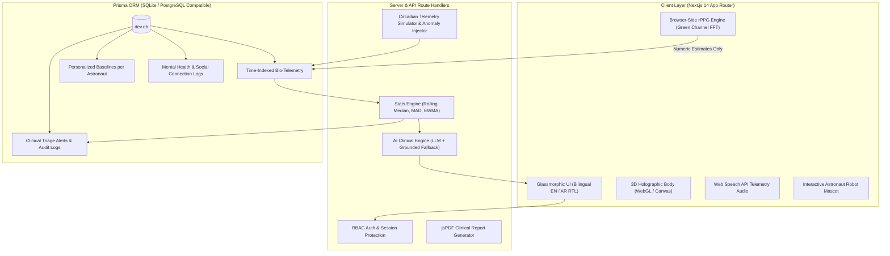

# VITAIOOP – Astronaut Health & Wellbeing
> **Tagline:** *"Beyond Health Monitoring, Toward Complete Astronaut Wellbeing."*  
> **Mission Context:** Mission Artemis III (Demo) – Lunar & Deep Space Crew Monitoring  
> **Bilingual:** Native English & العربية (with full RTL support)

---

## 🚀 Quick Start Guide

### 1. Requirements
- Node.js >= 18.17 (Tested on Node.js v20.18.0)
- npm >= 9.x

### 2. Installation & Setup
```bash
# 1. Install dependencies
npm install

# 2. Push database schema to SQLite
npx prisma db push

# 3. Seed realistic 30-day Artemis III crew telemetry
npm run db:seed

# 4. Launch development server
npm run dev
```

Open [http://localhost:3000](http://localhost:3000) in your web browser.

---

## 👥 Demo Accounts (1-Click Switcher Available in UI)

You can select any demo account directly on the Login page or use the **Role Switcher** in the top bar:

| Role | Name & Email | Password | Access Scope |
|---|---|---|---|
| **Astronaut (Primary)** | Dr. Sara Ahmed (`sara@artemis.space`) | `password123` | Own biometrics, rPPG camera, sleep, mental wellbeing logs, family letters. |
| **Astronaut (Commander)** | Cmdr. Alex Rivera (`alex@artemis.space`) | `password123` | Mission commander telemetry & EVA recovery status. |
| **Flight Surgeon (Medical)** | Dr. Marcus Vance (`vance@artemis.space`) | `password123` | All crew telemetry, anomaly triage, clinical notes log, PDF exports. |
| **Mission Control** | Director Wei Chen (`chen@artemis.space`) | `password123` | Space station environmental atmosphere, EVA readiness, mission timeline. |

---

## 🏛️ System Architecture



---

## 🔬 How the rPPG Camera Scan Works (Remote Photoplethysmography)

1. **Local In-Memory Capture:** Uses `navigator.mediaDevices.getUserMedia` to access the astronaut's webcam. Video frames are processed strictly in volatile browser RAM; **zero face images or frames are ever uploaded or saved**.
2. **Forehead & Cheek ROI:** Identifies the region of interest where capillary blood vessels are closest to the skin surface.
3. **Green Channel Extraction:** Computes spatial average of the Green (G) channel per frame (500–600 nm wavelength offers highest hemoglobin light absorption contrast).
4. **Detrending & Bandpass Filtering:** Removes slow baseline illumination drift using moving-average subtraction, followed by an IIR bandpass filter (0.7 Hz – 3.5 Hz for 42–210 BPM heart rate; 0.15–0.4 Hz for respiration).
5. **Autocorrelation & Frequency Peak Detection:** Determines dominant pulsatile frequency and respiration sinus arrhythmia (RSA).
6. **Signal Quality & Rejection Gate:** Calculates Signal-to-Noise Ratio (SNR) and head movement variance. Rejects scans with poor lighting or excessive motion to protect diagnostic integrity.
7. **Medical Honesty:** Strictly labeled as an experimental optical estimate; never used to measure blood pressure, SpO2, or core body temperature.

---

## 📈 Personal Baseline & Anomaly Detection

In microgravity, fluid redistribution towards the head alters resting cardiac stroke volume and autonomic tone. Terrestrial medical reference ranges generate excessive false alarms.

- **Personal Baseline:** Computed individually for each astronaut using **Rolling Median** and **Median Absolute Deviation (MAD)** over past flight days:
  $$\text{MAD} = \text{median}(|x_i - \text{median}(X)|)$$
- **Robust Z-Score Deviation:**
  $$Z = \frac{0.6745 \times (x_{\text{current}} - \text{median})}{\text{MAD}}$$
- **EWMA Change-Point:** Exponentially Weighted Moving Average ($\alpha = 0.25$) tracks when shifts began and automatically triggers prioritized clinical alerts.

---

## 🎮 Interactive Anomaly Injection (Judges Playground)

Judges and evaluators can test how VITAIOOP reacts to acute microgravity medical edge cases:
1. Navigate to **Devices & Simulator** (`/devices`) or use the top banner on the Overview page.
2. Click **+Tachycardia** (forces HR to 122+ BPM, testing >+38% baseline threshold alert).
3. Click **+Hypoxemia** (drops SpO2 to 93.8% to simulate localized cabin air circulator stagnation).
4. Watch the top bar alert indicator blink red, the 3D body hologram pulse with cardiac warning color, and an auto-triage alert appear in the **Alerts Center** (`/alerts`).
5. Click **Reset / Clear Anomaly** to normalize telemetry back to nominal baseline.

---

## 🐳 Docker Deployment

```bash
# Build and run with docker-compose
docker-compose up --build -d

# App accessible at http://localhost:3000
```

---

## ⚖️ Honesty & Ethics Statements

- **VITAIOOP is an educational, research prototype** designed to demonstrate advanced human-centered telemetry and wellbeing concepts for deep space missions.
- **Not officially affiliated with or endorsed by NASA.** Mention of Artemis III, Gateway, and Orion is for educational mission context only.
- **AI does not provide medical or psychological diagnosis.** It synthesizes authorized operational facts to assist human flight surgeons and astronauts.

